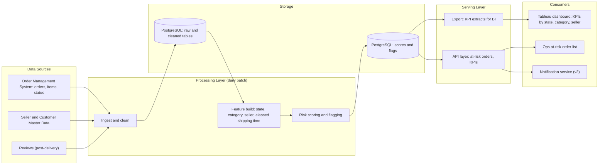

# System Design: Delivery Risk Early-Warning

*Part of an independent portfolio project using the public Olist dataset. This is a proposed design for a hypothetical system; the portfolio implementation covers the analysis layer and a Tableau dashboard, not a production deployment.*

## 1. Purpose & Scope

Translate the requirements in [functional-requirements.md](functional-requirements.md) into a buildable architecture. The MVP covers FR-01, FR-02, FR-03, FR-05, FR-06. Items marked **(v2)** are designed for but not built in the first release.

## 2. Architecture Overview

## 3. Components

| Component | Responsibility | Requirement | Implementation in this project |
|---|---|---|---|
| Ingest and clean | Load order, item, customer, seller, and review data; parse dates; drop undelivered orders from historical analysis | FR-06 | pandas script + PostgreSQL load |
| Feature build | Compute features per order: destination state, product category, seller, days elapsed vs. estimated window | FR-01 | SQL views / pandas |
| Risk scoring | Produce a risk score per in-transit order (see §4) | FR-01 | Python function; backtested on historical data |
| Flagging | Mark orders above threshold at least 24h before the estimated delivery date | FR-02 | Threshold parameter |
| Storage | Hold cleaned data, scores, flags, and outcomes | FR-05, FR-06 | PostgreSQL |
| API layer | Serve the at-risk list and KPI aggregates to consumers | FR-05 | Designed only (not built) |
| KPI export | Provide flat extracts for the BI tool | FR-03 | CSV export from PostgreSQL |
| Dashboard | Visualize late rate by state, category, seller; delay vs. review score | FR-03, FR-04 | **Tableau Public** |
| Notification service | Send delay notices to customers | FR-08 | **(v2)** |

## 4. Risk Scoring Logic (MVP)

Rule-based, chosen for transparency and easy backtesting against the Olist history.

**Inputs per in-transit order:**
- Destination state historical late rate (e.g., AL 21.4% vs. SP 4.5%)
- Product category historical late rate
- Seller historical late rate
- Share of the estimated delivery window already elapsed

**Score:** weighted combination of the historical late rates and the elapsed-window share, normalized to 0–1.

**Flag rule:** `score >= threshold` and `days_to_estimated_delivery >= 1`.

**Validation:** backtest on historical orders and measure the share of actually-late orders that would have been flagged 24h or more before the deadline (Success Metric 1: 70% target), alongside the false-positive rate. A statistical or ML model is a v2 option once the rule-based baseline exists.

## 5. Non-Functional Requirements

| ID | Category | Requirement | Rationale |
|---|---|---|---|
| NFR-01 | Data freshness | At-risk flags recalculated once daily | Delivery windows span days; daily cadence is sufficient (FR-06) |
| NFR-02 | Data volume | Handle ~100K historical orders and ~100K new orders per year without redesign | Olist scale (~100K orders over 2 years) |
| NFR-03 | Performance | Daily batch completes in under 15 minutes; dashboard filters respond in under 3 seconds | Keeps Ops workflow usable |
| NFR-04 | Accuracy | Flag precision and recall reported and reviewed monthly | Supports threshold tuning (feedback loop in TO-BE process) |
| NFR-05 | Auditability | KPI definitions follow [data-dictionary.md](data-dictionary.md); every dashboard number traceable to a SQL query | Numbers must be reproducible |
| NFR-06 | Privacy | Use anonymized identifiers only; no customer PII in extracts or dashboards | Olist data is anonymized; same standard applies in production |
| NFR-07 | Availability | Batch failure alerts the owner; the previous day's flags remain visible | Avoids an empty Ops list on failure |
| NFR-08 | Maintainability | Scoring parameters (weights, threshold) stored as configuration, not hard-coded | Allows tuning without code changes |

## 6. Integration Points

Not built in this project; documented to show how the design connects to existing systems.

| System | Direction | Data exchanged | When |
|---|---|---|---|
| Order Management System | Inbound | Orders, items, status, estimated delivery date | MVP |
| Carrier / tracking feed | Inbound | Shipment status events | v2 (real-time) |
| Seller portal | Outbound | Seller scorecard | v2 (FR-07) |
| Customer notification service (email/SMS) | Outbound | At-risk order alerts | v2 (FR-08) |
| BI tool (Tableau) | Outbound | KPI extracts | MVP |

## 7. Moving from Static Data to Real-Time

The portfolio build uses a static historical dataset. A production design would change as follows:

| Area | Static (this project) | Production |
|---|---|---|
| Ingestion | One-time CSV load | Scheduled extraction from the order system, then event stream (v2) |
| Scoring | Batch over history | Daily batch (MVP), event-driven rescoring (v2) |
| Flag validation | Backtest | Live precision/recall tracking |
| Dashboard | Tableau Public over CSV extracts | Tableau Server/Cloud or Power BI over a live database connection |
| Access control | Public (anonymized data) | Role-based access for Ops, Support, and sellers |

## 8. Assumptions & Limitations

- Historical delivery patterns by region, category, and seller are assumed to predict future risk.
- The Olist data has no real-time shipment events; elapsed-time features are simulated from order timestamps in the backtest.
- Rule-based scoring is a baseline and will miss risk factors not present in the dataset (weather, carrier capacity, holidays).
- Tableau Public cannot connect to a live PostgreSQL database; the portfolio dashboard reads CSV extracts, which is why the design includes an export step.
- Success-metric targets are hypothetical and cannot be validated on real outcomes.