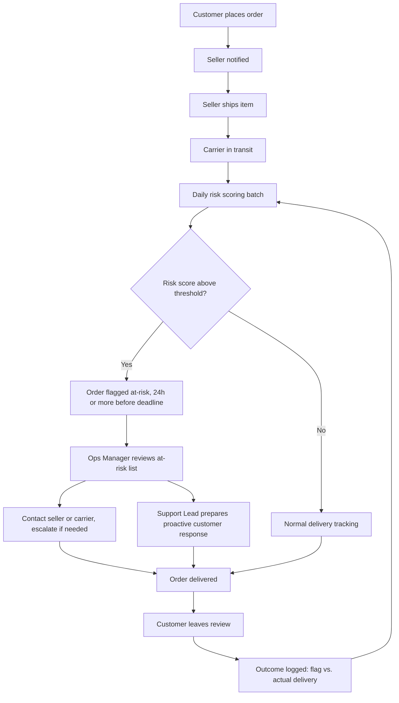

# TO-BE Process & Gap Analysis

*Part of an independent portfolio project using the public Olist dataset. The proposed process is a hypothetical design based on the findings in [current-state-analysis.md](current-state-analysis.md); it does not describe a real company's operations.*

## 1. TO-BE Process Map

The key change from the AS-IS process: a **risk-scoring and alert step** is inserted between shipment and delivery, so Operations can intervene *before* an order misses its estimated delivery date.

**Feedback loop (N → E):** actual delivery outcomes are logged against flags so the threshold and scoring logic can be re-tuned over time.

## 2. Who Acts on the Alert

| Step | Actor | Action |
|---|---|---|
| Review at-risk list | Operations Manager | Sorts flagged orders by region and risk score (FR-05); prioritizes follow-up in high-risk states (e.g., AL, MA, SE) |
| Seller/carrier follow-up | Operations Manager | Contacts the seller or carrier for flagged orders; escalates repeat offenders |
| Proactive response | Customer Support Lead | Prepares messaging for likely-late orders before complaints arrive (US-03) |
| Monitor KPIs | Operations Manager | Tracks late rate by state, category, and seller on the dashboard (FR-03) |

## 3. Gap Analysis (AS-IS vs. TO-BE)

| Area | AS-IS (Current State) | TO-BE (Proposed) | Gap / Change Required | Why (Evidence) |
|---|---|---|---|---|
| Late-delivery detection | Lateness is only known after the order is delivered late | At-risk orders flagged 24h or more before the deadline | New risk-scoring step (FR-01, FR-02) | 6.8% of delivered orders arrive late with no advance warning |
| Visibility | No consolidated view of delivery performance | KPI dashboard by state, category, and seller | Build dashboard (FR-03) | Late rate ranges from 2.7% (AM) to 21.4% (AL), invisible without aggregation |
| Ops prioritization | Ad-hoc, manual analysis | Sorted at-risk order list with region and risk score | New Ops view (FR-05) | Regional variation is large, so triage by region is high-value |
| Update frequency | None | Daily recalculation | Scheduled batch job (FR-06) | Daily cadence is sufficient for multi-day delivery windows |
| Customer communication | Reactive; customers learn of delays on arrival | Support prepares proactive responses (automation in v2) | Process change now, system change in v2 (FR-08) | Late orders average 2.27 stars vs. 4.29 on-time |
| Feedback / learning | No link between prediction and outcome | Outcomes logged against flags | Add outcome logging and threshold tuning | Needed to validate the 70% early-detection target |

## 4. Impact on Stakeholders

| Stakeholder | Change to their work |
|---|---|
| Operations/Logistics Manager | Gains a prioritized daily worklist instead of post-hoc reports |
| Customer Support Lead | Can anticipate delay-related contacts and prepare responses |
| Regional Sellers | Receive visibility into their own late rate (v2 scorecard, FR-07) |
| Customers | Fewer unexpected late deliveries; proactive notification in v2 |

## 5. Transition Notes

- **MVP (v1):** FR-01, FR-02, FR-03, FR-05, FR-06 — scoring, flagging, dashboard, Ops list, daily batch.
- **v2:** seller scorecards, automated customer notification, real-time data integration.
- The Ops follow-up process (who calls the seller or carrier, escalation rules) is an organizational change, not a system feature; it is listed as an assumption in the [BRD](BRD.md).